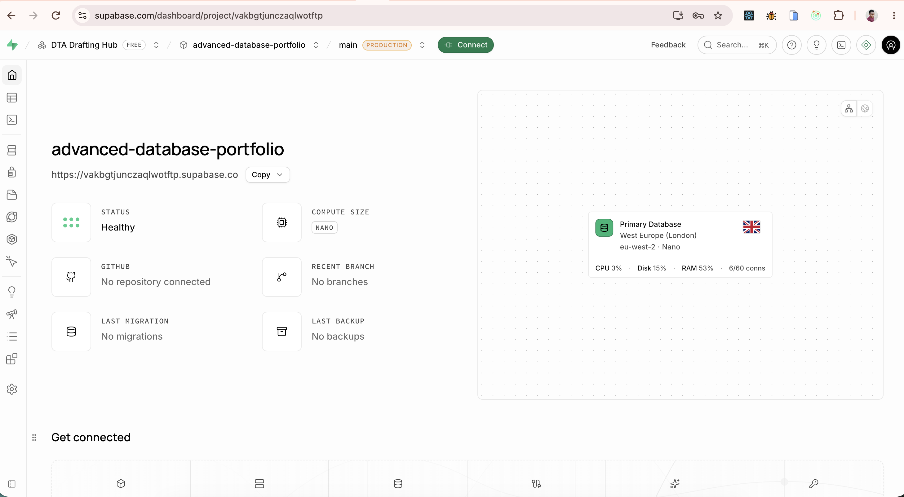
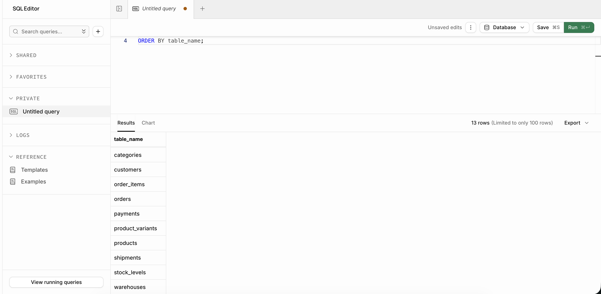
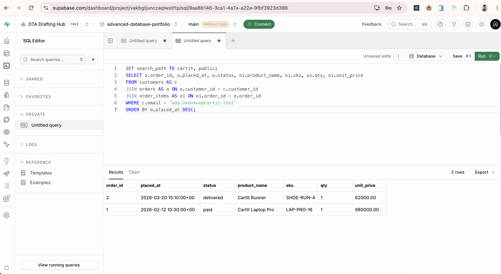
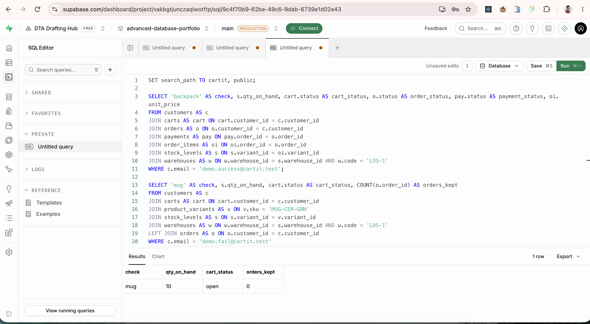

# MIT 8103 — CartIt advanced database portfolio

**Course:** MIT 8103 Advanced Database Systems
**Session:** 2026/2027, first semester
**Student:** Omobayode Festus Osinubi
**Student ID:** 301900904
**Case study:** CartIt, a simulated Nigerian e-commerce platform
**GitHub:** https://github.com/Omobayode6/advanced-database-portfolio

CartIt is not a website. The portfolio is the database behind a shop: relational design, SQL and execution plans, transactions, a document catalog, and a cloud deployment with a distribution design. The same shop is used in every section. Prices are in naira. Warehouses are in Lagos, Abuja, and Port Harcourt.

## 1. Database design and modelling

CartIt has three kinds of user. A shopper saves an address, fills a cart, pays, and tracks delivery. An admin maintains the catalog and reads revenue and unpaid orders. A warehouse officer reads stock and records a shipment.

The model separates customers, addresses, nested categories, products, variants, warehouses, stock, carts, orders, order lines, payments, and shipments. Primary keys, foreign keys, and `CHECK` constraints are in `portfolio-1-database-design/schema.sql`. Email, SKU, warehouse code, and tracking number are alternate keys. A shopper has at most one default address and one open cart.

The design was normalised from a single spreadsheet row that tried to store two products, the shopper, the city, the payment, and the tracking number in one line. Repeating product columns were removed (first normal form). Line facts were split from order facts (second normal form). Addresses were split from orders, because a city is a fact about an address (third normal form).

`order_items` still stores the product name, SKU, and unit price. Those values are copied at checkout. They are the price the shopper was charged. If the only stored price were today's `list_price`, changing the catalog would rewrite old revenue. The copy is intentional. The argument is written out in `portfolio-1-database-design/04-normalisation.md`, with the entity diagram in `02-er-diagram.md`.

The schema is loaded into PostgreSQL on Supabase, in a schema named `cartit`. `seed.sql` loads eight shoppers, four script fixtures, 15 products, three warehouses, and a small set of 2026 orders.

## 2. Query processing and optimisation

Five queries support the shop. They report first-quarter revenue from the snapshotted line price, list orders still unpaid after two days, list variants a warehouse still has but only one to five units of, return Ada Okonkwo's order history, and total paid March 2026 revenue for Lagos delivery addresses.

The March report is the one that is planned twice. `explain.sql` drops the extra indexes, runs `EXPLAIN (ANALYZE, BUFFERS)`, creates indexes on order date, order status, address city, and the foreign keys used by the joins, then plans the same statement again. `customers.email` was already indexed by its unique constraint, and Ada's history query is not the statement under test.

A volume load of 4,000 extra shoppers, with two already-paid orders each, gives the planner a table where a date index can matter. Those rows are historical report data. They do not reduce stock. On the named sample alone, both plans are often sequential scans, because the table fits in a page. The recorded plans, timings, and buffer counts are in `portfolio-2-query-optimisation/evidence/`, and the reading of sequential scan versus index or bitmap scan is in `analysis.md`.

## 3. Transactions and concurrency

`place_order` checks out one open cart against one warehouse. It locks the stock row, inserts the order as `pending_payment`, copies the line price from `list_price`, decreases stock, and either captures a payment and marks the order `paid`, or raises `Payment declined`.

For `demo.success@cartit.test` the transaction commits. The backpack cart becomes `checked_out`, a captured payment exists, and Lagos stock for `BAG-PACK-OS` falls from 40 to 39.

For `demo.fail@cartit.test` the payment error is caught by an inner PostgreSQL block, which undoes the function's writes. Mug stock stays at 10, the cart stays open, and no order remains.

The concurrency script then opens two sessions on the last unit of `DEMO-LAST-UNIT` in Lagos. Under Read Committed, both sessions can read quantity 1 and both can write 0, producing two paid orders for one unit. The stock check constraint does not catch it, because the stored quantity is never negative. `SELECT … FOR UPDATE` makes the second session wait and then roll back when it sees 0. A further section starts a Repeatable Read transaction, lets the other session commit a change to the same row, and records the serialization error. Output is in `portfolio-3-transactions-concurrency/evidence/`.

## 4. NoSQL and a document catalog

Orders and stock stay relational. Product attributes do not share one set of columns: a shoe has a size, a laptop has RAM and storage. `portfolio-4-nosql/catalog.js` loads six documents into an embedded MongoDB, queries in-stock electronics with at least 16 GB of RAM, and updates the 16 GB laptop's storage without adding a RAM field to the shoe. The 8 GB laptop and the out-of-stock 32 GB laptop are absent from the result.

The same note explains, without a second implementation, where a key-value cart, a columnar finance extract, and a graph of "also bought" products would fit. The SKU is the link between a document and the relational variant that an order line is allowed to reference.

## 5. Distributed and cloud deployment

The schema above is deployed on Supabase, region **eu-west-2**, project **advanced-database-portfolio**. That is one primary PostgreSQL database. It provides a hosted engine for the schema, the plans, and the checkout. It is not a sharded cluster.

The distribution design for a larger CartIt is in `portfolio-5-distributed-cloud/architecture.md`. Catalog reads may use a replica. Checkout and the stock lock stay on the primary, so a stale "1 left" on a product page cannot sell the unit twice. Orders would shard by warehouse region, with the payment stored on the same shard as the order so `place_order` remains one local commit. Product rows would be copied to every shard. A network split refuses an uncertain checkout and still serves the catalog from a reachable replica. A report that sums every region would have to visit every shard.

## Evidence and repository layout

`README.md` at the repository root lists every command. Text output from the scripts is in each portfolio's `evidence` folder. The two execution plans are in `portfolio-2-query-optimisation/evidence/explain.txt`. The Supabase screenshots are below.

Supabase project home, region `eu-west-2`.

The `cartit` tables.

Ada Okonkwo's orders.

Backpack checkout committed at stock 39. Mug stock stayed at 10 after the declined payment.

## Reflection

On the March Lagos report, `orders` was a sequential scan before the extra indexes and an index scan on `idx_orders_status_placed_at` after them. Execution time fell from 5.003 ms to 2.271 ms. The unlocked race for the last sneaker ended at `qty_on_hand=0` with two paid orders. `SELECT … FOR UPDATE` left one paid order. The committed backpack line kept `unit_price` 35000.00, so a later catalog change would not rewrite that sale. Checkout has to lock stock on the primary. A replica can still say one unit is left after that unit has been sold.

The full reflection is in [reflection-template.md](reflection-template.md).

## References

- PostgreSQL Global Development Group. *EXPLAIN*. https://www.postgresql.org/docs/current/sql-explain.html
- PostgreSQL Global Development Group. *Transaction Isolation*. https://www.postgresql.org/docs/current/transaction-iso.html
- MongoDB, Inc. *Data Modeling Introduction*. https://www.mongodb.com/docs/manual/data-modeling/
- Supabase. *Database overview*. https://supabase.com/docs/guides/database/overview

## AI-use declaration

See `docs/ai-use-declaration.md`.
