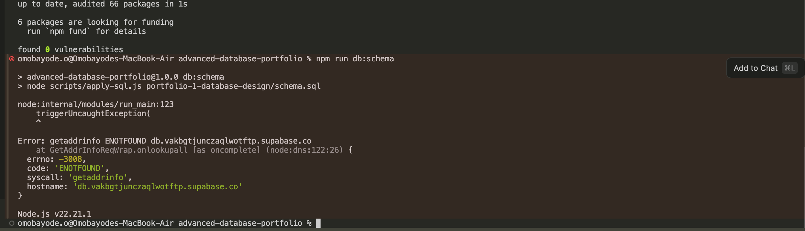

# Technical reflection

## Design

I kept `product_name`, `sku`, and `unit_price` on `order_items` after normalisation. Those columns are the name and the price charged on the day of the sale, copied from the variant at checkout. Changing `product_variants.list_price` later updates the catalog only. In `portfolio-3-transactions-concurrency/evidence/transactions.txt`, the committed backpack line still shows `unit_price` 35000.00. That figure stays on the order even if the backpack's list price changes tomorrow.

## Queries

Before the extra indexes, `evidence/explain.txt` says: `Seq Scan on orders o  (cost=0.00..235.20 rows=800 width=16) (actual time=0.010..1.885 rows=796 loops=1)`, and that scan removed 7,214 rows. After the indexes, the same file says: `Index Scan using idx_orders_status_placed_at on orders o  (cost=0.28..64.37 rows=800 width=16) (actual time=0.070..0.572 rows=796 loops=1)`. The whole query went from 5.003 ms to 2.271 ms. The buffer line on that `orders` node rose from `shared hit=75` to `shared hit=730 read=5`, because the index pages are counted. The time still fell, and the second plan no longer threw those 7,214 rows away by hand.

## Transactions

The lost-update section printed `qty_on_hand=0, paid orders=2`. Both sessions had read 1 and both had written a paid order. When the script used `SELECT … FOR UPDATE`, the same file printed `paid orders=1`. The second session waited, read 0, and rolled back.

## Documents

A shoe and a laptop do not share one set of fields. The size-42 runner document stores `size` and `colour` and has no `ramGb`. The query asks for in-stock electronics with `attributes.ramGb` of at least 16, so it still returned `LAP-PRO-16` and left the shoe out. Missing a field is not the same as failing the query.

## Distribution

A product page can read a replica, because a slightly late price or stock figure on a browsing page is acceptable. `place_order` cannot. It locks `stock_levels` on the primary and copies the price from that primary onto the order line. A replica that still says one sneaker is left would sell the same unit twice.

## Difficulty

The first time I ran `npm run db:schema`, the script failed before it reached PostgreSQL.

The direct Supabase host, `db.<project-ref>.supabase.co`, exists only as an IPv6 address. This machine has no IPv6 address, so Node's `getaddrinfo` lookup failed with a name-resolution error and the connection never started. I replaced `DATABASE_URL` with the session pooler URI on port 5432, with the user `postgres.<project-ref>`. That host has an IPv4 address, and the session pooler keeps one backend for the life of the connection, which is what the row lock in the concurrency demo needs. The transaction pooler on port 6543 would have connected and then hidden that lock, so I did not use it. After the pooler string was in `.env`, `db:schema` and the rest of the scripts ran.
