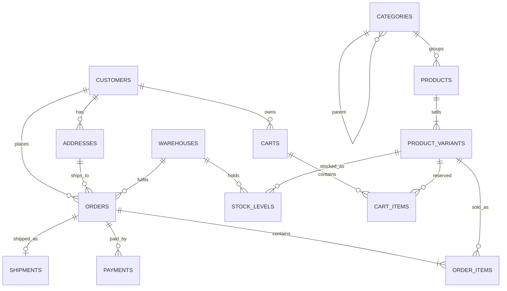

# CartIt entity-relationship model

The operational database is a relational model in the `cartit` schema. Portfolio 4 later stores flexible product attributes as documents. Those documents do not replace these tables.

## Keys and relationships

- `customers.customer_id` identifies a shopper. `email` is an alternate key.
- `addresses.address_id` identifies one saved address. `customer_id` says whose address it is. At most one row per shopper has `is_default = true`.
- `categories.category_id` identifies a category. `parent_category_id` points at another category, so Laptops can sit under Electronics. The parent is optional.
- `products.product_id` identifies a catalog product. It belongs to one category.
- `product_variants.variant_id` identifies a sellable unit. `sku` is an alternate key. The variant belongs to one product.
- `warehouses.warehouse_id` identifies a building. `code` (`LOS-1`, `ABJ-1`, `PHC-1`) is an alternate key. `region` is the value Portfolio 5 uses as a shard key.
- `stock_levels` uses the pair `(warehouse_id, variant_id)` as its primary key. Quantity cannot be negative.
- `carts.cart_id` identifies a cart. A shopper has at most one row with `status = 'open'`.
- `cart_items` uses `(cart_id, variant_id)` as its primary key.
- `orders.order_id` identifies a checkout. It points at the shopper, the address copied for delivery, and the warehouse that fulfils it.
- `order_items.order_item_id` identifies one line. It points at the variant and also stores the product name, SKU, and unit price charged on that day.
- `payments.payment_id` identifies an attempt to collect money for an order.
- `shipments.shipment_id` identifies a parcel. `order_id` is unique here: this model ships each order as one parcel. `tracking_number` is an alternate key.

## Status values enforced in the schema

- Cart: `open`, `checked_out`, `abandoned`
- Order: `pending_payment`, `paid`, `packed`, `shipped`, `delivered`, `cancelled`
- Payment: `pending`, `captured`, `failed`
- Shipment: `label_created`, `in_transit`, `out_for_delivery`, `delivered`, `exception`
- A delivered shipment must have `delivered_at`
