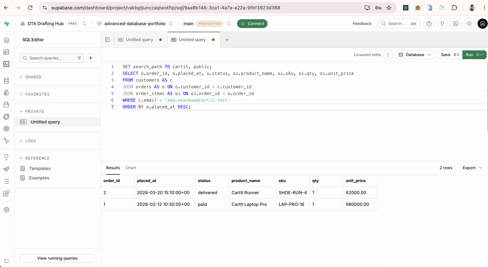

# Portfolio 2 — Query processing and optimisation

These queries answer CartIt questions against the `cartit` schema from Portfolio 1.

## Files

- [queries.sql](queries.sql) — five business queries
- [seed-volume.sql](seed-volume.sql) — 4,000 extra shoppers and two paid orders each, so the planner has something to chew on
- [indexes.sql](indexes.sql) — the extra indexes, kept here so they can be applied on their own
- [explain.sql](explain.sql) — drops those indexes, prints a plan, creates them, prints the plan again
- [analysis.md](analysis.md) — how to read the two plans

## How to run

```bash
npm run db:volume
npm run db:queries
npm run db:explain
```

`npm run db:queries` writes `evidence/query-results.txt`. `npm run db:explain` writes `evidence/explain.txt`. Those two files are the rows and both execution plans from the Supabase database.

## What each query is for

1. Revenue by product for 1 January 2026 through 31 March 2026, using the price stored on the order line.
2. Orders still in `pending_payment` after two days. Chinedu Bello (1 November 2026) and Tunde Adeyemi (28 October 2026) are the named examples.
3. Variants that a warehouse still has, but only one to five units. `DEMO-LAST-UNIT` in Lagos (quantity 1), groundnut oil in Lagos (3), and the green mug in Abuja (4) are the named examples. A quantity of 0 means that building does not carry the variant, so it is left out of this alert.
4. Ada Okonkwo's order history. The Supabase result is below.


5. The heavy report: paid March 2026 revenue for Lagos delivery addresses. This is the statement `explain.sql` plans twice.

The volume load is marked as already paid and does not reduce stock. It exists so the March report is large enough for an index to matter.
