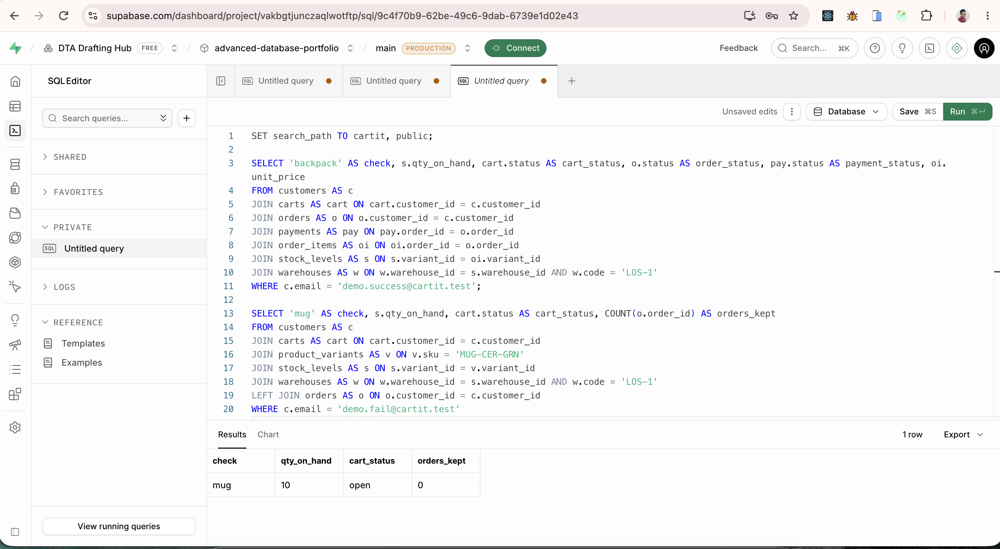

# Portfolio 3 — Transactions and concurrency

A CartIt checkout is one unit of work. The order, the snapshotted line, the stock decrease, and the payment are saved together or not at all.

## Files

- [transactions.sql](transactions.sql) — `place_order`, one committed checkout, one declined payment
- [concurrency-demo.js](concurrency-demo.js) — two database sessions racing for `DEMO-LAST-UNIT`

## How to run

```bash
npm run db:transactions
npm run concurrency
```

The first command writes `evidence/transactions.txt`. The second writes `evidence/concurrency-output.txt`. Those files are the Supabase run: the backpack checkout commits, the mug checkout rolls back, the unlocked race sells the last sneaker twice, and `FOR UPDATE` lets only one sale through.



Use the direct Supabase connection on port 5432. The transaction pooler (port 6543) can hand the two sessions to different backends and will hide the lock wait this demo needs.

## What a committed checkout changes

`demo.success@cartit.test` has an open cart with one backpack (`BAG-PACK-OS`). Lagos starts with 40. After `COMMIT`:

- the cart is `checked_out`
- a new order is `paid`
- a payment is `captured`
- the line stores the backpack price taken from `list_price` at that moment
- Lagos stock for `BAG-PACK-OS` is 39

`place_order` locks the stock row with `SELECT … FOR UPDATE` before it decreases the quantity.

## What a rollback changes

`demo.fail@cartit.test` has an open cart with one mug. `place_order` is called with `p_force_fail = true`. The function inserts a failed payment and then raises `Payment declined`.

The `DO` block catches that error. In PostgreSQL, the inner `BEGIN … EXCEPTION` rolls the function's work back to the start of that block. The following `SELECT` is the evidence:

- mug stock in Lagos is still 10
- the cart is still `open`
- the shopper has no order

The declined payment is not kept. Keeping a failed-payment audit row would be a second transaction after the checkout has already been undone. This portfolio shows the undo itself.

## Isolation and the last sneaker

The default isolation level used here is **Read Committed**. Each statement sees rows that are already committed. It does not, by itself, stop this application bug:

1. Session A reads `qty_on_hand = 1` and remembers the number in Node.
2. Session B reads `qty_on_hand = 1` as well.
3. Both wait, then both write `qty_on_hand = 0` and both insert an order.

The stock column ends at 0, which looks legal, and two shoppers each have a paid order for the only unit. That is a lost update. The check constraint never fires, because nobody writes a negative number. The damage is the extra order.

`SELECT … FOR UPDATE` is the control. The first session locks the stock row. The second session's `SELECT … FOR UPDATE` waits. When the first session commits, the second session reads 0 and rolls back. One order remains.

**Repeatable Read** is a different control. Session A reads the quantity and holds a snapshot. Session B sets the quantity to 0 and commits. Session A's later `UPDATE` of that same row should fail with a serialization error (`could not serialize access due to concurrent update`). The demo records the message your database returns. Checkout in this portfolio still uses the explicit lock, because the lock also works in Read Committed and the wait is easy to see in the log.
