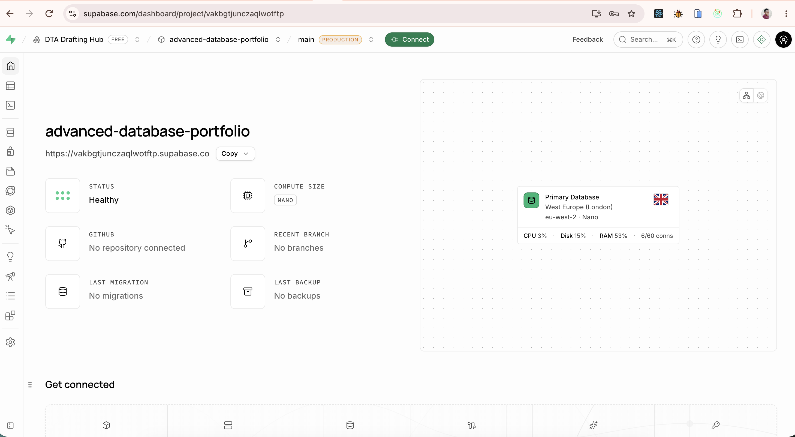
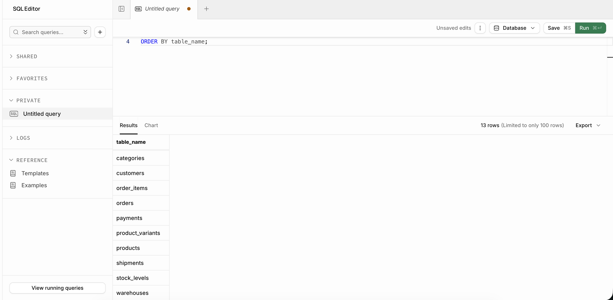
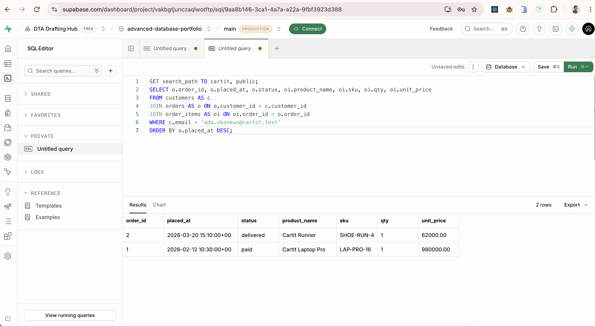
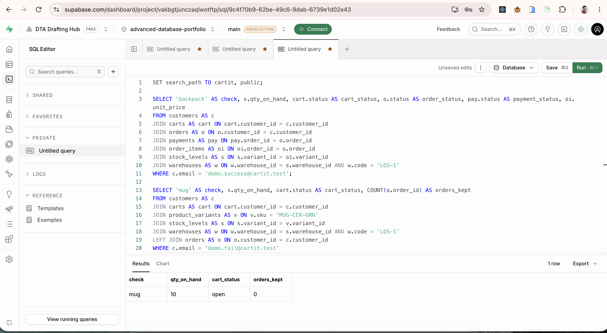

# Portfolio 5 — Distributed and cloud database

CartIt's live database for this portfolio is one PostgreSQL instance on Supabase, project `advanced-database-portfolio`, region `eu-west-2`. [architecture.md](architecture.md) says how CartIt would add replicas and region shards, and which operations must stay on the primary. How to rerun the schema is in the repository [README](../README.md).

## Screenshots

Supabase project home, region `eu-west-2`.

The `cartit` tables listed from the SQL editor.

Ada Okonkwo's two orders: the Laptop Pro is paid, and the Runner is delivered.

The backpack checkout committed with stock 39. The declined mug payment left stock at 10.

## What is implemented

- The `cartit` schema from Portfolio 1, loaded into a cloud PostgreSQL service
- Checkout and the stock lock running on that primary
- A written design for replicas, for sharding orders by `warehouses.region`, and for what happens when regions cannot talk

## What is not claimed

This student database is one primary in `eu-west-2`. It is not a sharded cluster. Supabase backups and a region name are not a replica that was queried.
